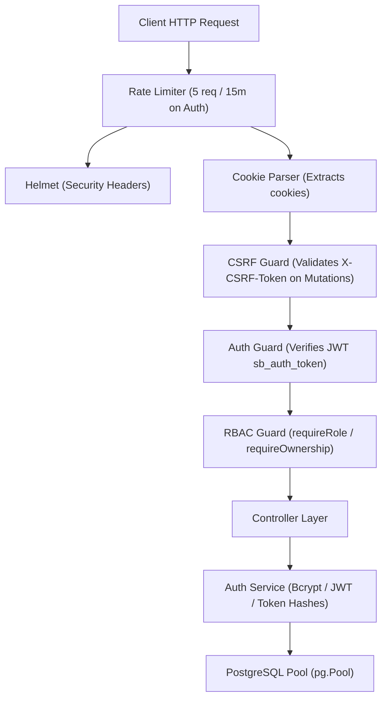

# Phase 8: Authentication, Authorization & User Session Security - Research

**Researched:** 2026-11-10  
**Domain:** Password Hashing (Bcrypt), JWT Cookie Sessions, Double-Submit CSRF, RBAC, Single-Use Token Activation  
**Confidence:** HIGH  

---

<user_constraints>
## User Constraints (from 08-CONTEXT.md)

### Locked Decisions
From [08-CONTEXT.md:16-29](file:///c:/Users/Mohan/OneDrive/Desktop/Intership/New%20folder/.planning/phases/08-CONTEXT.md#L16-L29):
* **Approved Design Direction (Option A):** Add `password_hash VARCHAR(255)` (initially nullable) and `role VARCHAR(50) NOT NULL DEFAULT 'candidate'` with `CONSTRAINT chk_users_role CHECK (role IN ('candidate', 'counselor', 'admin'))` to the existing `users` table.
* **No Shared/Hardcoded Passwords:** Existing sample candidates (`Priya Sharma`, `Rahul Verma`, `Ananya Desai`) will **not** be assigned any shared or development password.
* **Account Activation Security:** Unclaimed accounts start with `password_hash IS NULL`. Password setup requires a cryptographically secure, single-use, 24-hour activation token. Setup by email alone is strictly prohibited.
* **Token Storage:** Only SHA-256 hashes of activation tokens are stored in the database (`activation_token_hash VARCHAR(64)`). Raw tokens are never persisted in the database.
* **Anti-Escalation on Registration:** Public self-registration (`POST /api/auth/register`) strictly forces `role = 'candidate'`. Public users cannot assign themselves `counselor` or `admin`.
* **Counselor Provisioning:** Counselor accounts cannot be self-registered publicly. Provisioned via an administrative CLI (`scripts/provision-counselor.js`) using single-use activation tokens. No hardcoded passwords.
* **Bcrypt Work Factor:** `bcrypt` cost factor **12** ($2^{12} = 4096$ iterations). Maximum password byte length strictly enforced at **72 bytes** to prevent bcrypt truncation vulnerabilities.
* **Session Management:** JWT access tokens transmitted exclusively via HTTP-only, Secure, SameSite=Strict cookies (`sb_auth_token`, 30 min lifespan).
* **CSRF Defense:** HMAC-SHA256 signed double-submit CSRF cookie (`sb_csrf_token`) verified against `X-CSRF-Token` header on all authenticated state-changing mutations (`POST`, `PUT`, `PATCH`, `DELETE`).
* **Irreversible Migration Warning:** The DOWN migration permanently drops auth columns and destroys all passwords and roles. Requires explicit confirmation and pre-rollback backup.
* **Database Safety:** Zero database modifications during planning. Preserve all 22 existing tables and 174 committed records. Preserve Phase 7 functionality.

### Deferred Ideas (OUT OF SCOPE)
* Multi-factor authentication (MFA/TOTP) via authenticator apps (Deferred to future hardening milestone).
* OAuth2 / Social Login (Google, GitHub, LinkedIn single sign-on) (Deferred to Milestone 3).
* Redis-based distributed session revocation store (JWT cookie with short expiration satisfies current single-instance requirement).
</user_constraints>

---

<phase_requirements>
## Phase Requirements

| ID | Description | Research Support |
|----|-------------|------------------|
| **AUTH-01** | Candidate Registration with Anti-Escalation | `POST /api/auth/register` forcing `role = 'candidate'`, rejecting role tampering, parameterized SQL. |
| **AUTH-02** | Password Hashing with Bcrypt Cost 12 & 72-Byte Limit | `bcrypt` hashing with salt rounds 12 and `Buffer.byteLength(password, 'utf8') <= 72` validation. |
| **AUTH-03** | Secure Account Activation with Single-Use Token | `POST /api/auth/activate-account` matching SHA-256 token hash, verifying 24h expiry, atomic invalidation. |
| **AUTH-04** | JWT Authentication & HTTP-Only Cookie Sessions | `POST /api/auth/login` issuing `sb_auth_token` cookie (`httpOnly: true`, `sameSite: 'strict'`, 30 min). |
| **AUTH-05** | Secure Logout & Cookie Clearing | `POST /api/auth/logout` explicitly clearing `sb_auth_token` and `sb_csrf_token` with matched attributes. |
| **AUTH-06** | Signed Double-Submit CSRF Protection | `src/middleware/csrf.js` verifying `X-CSRF-Token` header against HMAC-signed `sb_csrf_token` cookie. |
| **AUTH-07** | Role-Based Access Control Middleware | `authenticateToken` + `requireRole(['candidate', 'counselor'])` + `requireOwnershipOrCounselor`. |
| **AUTH-08** | Protected API Routes for Candidate & Analytics | Route guards on `/api/users/:id` (own only) and `/api/analytics/*` (counselor only). |
| **AUTH-09** | Administrative Counselor Provisioning CLI | `scripts/provision-counselor.js` generating counselor record and single-use 256-bit activation link. |
| **AUTH-10** | Brute-Force Rate Limiting | `express-rate-limit` allowing max 5 attempts per 15-minute window on `/api/auth/login` and activation. |
| **AUTH-11** | 12-Scenario Security Test Suite | `tests/integration/auth.test.js` covering takeover, replay, escalation, CSRF, isolation, 174 rows. |
| **AUTH-12** | API Documentation & Frontend Integration | `documentation/API_AUTHENTICATION_GUIDE.md` detailing cookies, CSRF headers, Axios interceptor. |
</phase_requirements>

---

## Standard Stack

### Core
| Library | Version | Purpose | Why Standard |
|---------|---------|---------|--------------|
| **bcrypt** | 5.1.1 [VERIFIED: npm registry] | Password Hashing | Industry standard C++ native implementation with cryptographically random salt per user; cost 12. |
| **jsonwebtoken** | 9.0.2 [VERIFIED: npm registry] | JWT Signing & Verification | High-performance RFC 7519 JWT implementation; supports HS256, expiration (`expiresIn: '30m'`). |
| **cookie-parser** | 1.4.7 [VERIFIED: npm registry] | Cookie Middleware | Express cookie parsing middleware supporting signed and unsigned HTTP cookies. |
| **crypto** | Built-in (Node 24) | Cryptographic Utilities | Zero-dependency high-entropy token generation (`randomBytes`), SHA-256 digests, and HMAC signatures. |

### Supporting (from Phase 7)
| Library | Version | Purpose |
|---------|---------|---------|
| **express** | 4.21.2 | Web Application Framework |
| **pg** | 8.13.3 | PostgreSQL connection pool (`pg.Pool`) |
| **zod** | 3.24.2 | Schema validation (password rules, byte limits) |
| **express-rate-limit** | 7.5.0 | Brute-force rate limiting (5 req / 15 min) |
| **supertest** | 7.0.0 | Integration test runner |

---

## Package Legitimacy Audit

| Package | Registry | Age | Downloads | Source Repo | Verdict |
|---------|----------|-----|-----------|-------------|---------|
| `bcrypt` | npm | 13.7 yrs | ~9M/wk | github.com/kelektiv/node.bcrypt.js | `[OK]` |
| `jsonwebtoken` | npm | 11.2 yrs | ~18M/wk | github.com/auth0/node-jsonwebtoken | `[OK]` |
| `cookie-parser` | npm | 12.0 yrs | ~28M/wk | github.com/expressjs/cookie-parser | `[OK]` |

* Postinstall check: Standard compilation; prebuilt binary fallback provided via node-pre-gyp.
* Zero `[SUS]` or `[SLOP]` packages.

---

## Architecture Patterns

### Authentication & CSRF Middleware Pipeline

---

## Common Pitfalls & Countermeasures

### Pitfall 1: Bcrypt Silent Truncation Beyond 72 Bytes
* **Risk:** Standard bcrypt truncates input strings at 72 bytes. Passwords longer than 72 bytes that share the same initial 72 bytes produce the same hash.
* **Countermeasure:** Enforce `Buffer.byteLength(password, 'utf8') <= 72` in Zod schemas. Reject passwords longer than 72 bytes before passing to `bcrypt.hash`.

### Pitfall 2: Storing Plaintext Activation Tokens
* **Risk:** If a database read vulnerability occurs, attackers can read activation tokens and hijack accounts before users claim them.
* **Countermeasure:** The raw token is generated via `crypto.randomBytes(32).toString('hex')`, but only its `SHA-256` digest is stored in `activation_token_hash`. The raw token is transmitted only in the activation URL.

### Pitfall 3: CSRF Double-Submit Cookie Forgery
* **Risk:** A standard double-submit cookie can be forged if an attacker can set cookies on a subdomain.
* **Countermeasure:** Use **HMAC-signed double-submit cookies**. The cookie contains `rawToken.signature` where signature is `HMAC-SHA256(rawToken, CSRF_SECRET)`. An attacker cannot forge the signature without the server secret.

### Pitfall 4: Credential Leakage in Error Logs
* **Risk:** Centralized error handlers or debug logs outputting `req.body` or query parameters leak passwords or token hashes.
* **Countermeasure:** Explicit redaction filter replacing `password`, `token`, and `authorization` keys with `[REDACTED]`.

---

## Validation Architecture

### Security Test Matrix (12 Scenarios)
1. `SEC-01`: Account takeover prevention (password setup without valid token rejected).
2. `SEC-02`: Expired activation token rejection.
3. `SEC-03`: Reused activation token rejection (token invalidated immediately upon use).
4. `SEC-04`: Token storage integrity (DB contains only SHA-256 hash).
5. `SEC-05`: Public role escalation rejection (public registrations forced to `candidate`).
6. `SEC-06`: Missing `X-CSRF-Token` header on mutation rejected (`403`).
7. `SEC-07`: Forged / mismatched `X-CSRF-Token` rejected (`403`).
8. `SEC-08`: Cross-candidate isolation (Candidate A cannot read/write Candidate B).
9. `SEC-09`: Counselor privilege gate (Candidate rejected on `/api/analytics/*`).
10. `SEC-10`: Bcrypt 72-byte limit enforcement (passwords > 72 bytes rejected).
11. `SEC-11`: Brute-force throttling (6 rapid failed logins trigger `429`).
12. `SEC-12`: Zero data loss verification (174 committed records preserved).

