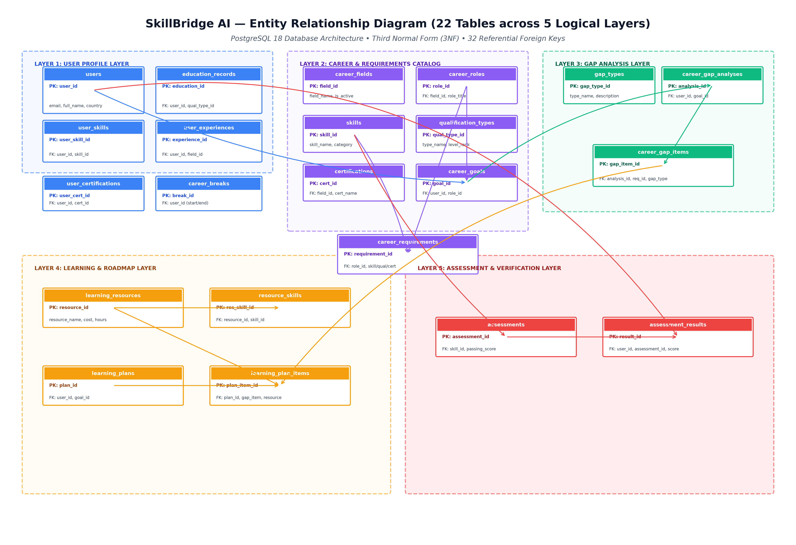

# SkillBridge AI — Database Architecture & PostgreSQL Schema Submission

**Project Repository:** [https://github.com/mohan5535/SkillBridge-AI](https://github.com/mohan5535/SkillBridge-AI)  
**Target RDBMS:** PostgreSQL (Verified on PostgreSQL 18.6)  
**Relational Design:** Third Normal Form (3NF) • 22 Tables • 32 Foreign Key Relationships • 12 Explicit Indexes  
**Baseline Dataset:** 157 Committed Seed Records across Multi-Disciplinary Personas (`sample_data.sql`)

---

## 1. Project Overview

**SkillBridge AI — Universal Career Gap Tracker** is a normalized PostgreSQL relational database engineered to evaluate where an individual stands today compared to their target career role, identify specific competency, educational, credential, or experience gaps, map learning resources to close those gaps, and track longitudinal assessment improvement.

Unlike conventional career tools restricted to software engineering resumes, SkillBridge AI uses a **sector-agnostic polymorphic requirements model** (`career_requirements`) and central shared catalogs (`skills`, `career_fields`, `qualification_types`, `certifications`, `gap_types`) so new professions and evaluation categories can be introduced via standard `INSERT` operations without modifying DDL (`schema.sql`).

* **Primary Schema Source:** [`schema.sql`](https://github.com/mohan5535/SkillBridge-AI/blob/main/schema.sql)
* **DBML Diagram Source:** [`er-diagram.dbml`](https://github.com/mohan5535/SkillBridge-AI/blob/main/er-diagram.dbml)
* **Sample Seed Script:** [`sample_data.sql`](https://github.com/mohan5535/SkillBridge-AI/blob/main/sample_data.sql)
* **Integrity Audit Suite:** [`integrity_checks.sql`](https://github.com/mohan5535/SkillBridge-AI/blob/main/integrity_checks.sql)

---

## 2. Real-World Domain and Database Objectives

### Real-World Problem Addressed
Career transitions, post-break workforce re-entry, and structured upskilling span vastly different industries (Information Technology, Healthcare, Accounting & Finance, Education, and Civil Engineering), each with distinct licensing rules, regional/jurisdictional expectations, and prerequisite education tiers. Storing these attributes as unstructured text or domain-specific columns leads to update anomalies, search failures, and biased automated filtering.

### Core Database Design Objectives
1. **Universal Extensibility (Open/Closed Schema):** Support diverse career domains (`career_fields`), jurisdiction-qualified roles (`career_roles`), and cross-sector skills (`skills`) without schema redesign.
2. **Programmatic Qualification & Gap Comparison:** Represent educational hierarchy quantitatively (`qualification_types.level_rank`) and link target roles cleanly to skills, degrees, and licenses (`career_requirements` enforced via `chk_career_req_exclusive_fks`).
3. **Ethical Career Break Representation:** Record workforce pauses (`career_breaks`) strictly as contextual information (`break_reason` constrained to 9 neutral categories) rather than disqualifying penalties.
4. **Data Minimization & Privacy:** Exclude government identification numbers and medical records; keep `date_of_birth` optional (`NULL` unless age-based exam eligibility applies).
5. **Historical Auditability & Improvement Tracking:** Store immutable point-in-time gap snapshots (`career_gap_analyses`) and multi-attempt assessment histories (`assessment_results`) to measure candidate growth over time.

---

## 3. All 22 Tables and Their Purposes

The database organizes **22 normalized tables** across **5 logical layers**:

| Layer | # | Table Name | Classification | Primary Purpose |
| :--- | :---: | :--- | :--- | :--- |
| **1. User Profile** | 1 | `users` | Entity | Minimal core identity, unique email, jurisdiction (`country`, `state_or_region`), optional DOB. |
| **1. User Profile** | 7 | `education_records` | Entity | Formal educational history linked to `users` and ranked via `qualification_types`. |
| **1. User Profile** | 8 | `user_skills` | **Junction** | Maps `users ↔ skills` with `proficiency_level`, `years_of_experience`, `evidence`, `last_used_date`. |
| **1. User Profile** | 9 | `user_experiences` | Entity | Work, internship, freelance, volunteer, or apprenticeship history optionally tagged to `career_fields`. |
| **1. User Profile** | 10 | `user_certifications` | **Junction** | Maps `users ↔ certifications` with `date_obtained`, `expiry_date`, `credential_id`, `status`. |
| **1. User Profile** | 11 | `career_breaks` | Entity | Neutral workforce pause records (`break_reason`, `start_date`, `end_date`, narrative). |
| **2. Catalog & Goals** | 2 | `career_fields` | Lookup / Entity | Broad professional sectors (`Information Technology`, `Healthcare and Medical`, etc.). |
| **2. Catalog & Goals** | 3 | `skills` | Lookup / Entity | Shared central skill catalog reusable across all sectors. |
| **2. Catalog & Goals** | 4 | `qualification_types` | Lookup | Normalized academic tiers with numeric `level_rank` (`1` = High School to `8` = PhD). |
| **2. Catalog & Goals** | 5 | `career_roles` | Entity | Specific job roles within a field, qualified by `jurisdiction`, `organization`, and experience threshold. |
| **2. Catalog & Goals** | 6 | `certifications` | Lookup / Entity | Catalog of recognized licenses and credentials (`certification_name`, `issuing_body`). |
| **2. Catalog & Goals** | 12 | `career_goals` | Entity / Bridge | Links `users` to target `career_roles` with `priority` (1–5), `target_date`, and `status`. |
| **2. Catalog & Goals** | 13 | `career_requirements` | Entity | Polymorphic role demands (`skill`, `education`, `certification`, `experience`, `eligibility`, `other`). |
| **3. Gap Analysis** | 14 | `gap_types` | Lookup | Extensible categories (`Skill Gap`, `Education Gap`, `Career Break Impact`, etc.). |
| **3. Gap Analysis** | 15 | `career_gap_analyses` | Entity | Timestamped gap-analysis snapshots per user goal storing historical `overall_readiness_pct`. |
| **3. Gap Analysis** | 16 | `career_gap_items` | Entity | Granular unmet/partially met items inside an analysis (`gap_severity`, `priority`, `status`). |
| **4. Learning** | 17 | `learning_resources` | Entity | Curated courses, books, tutorials, workshops, mentorships, and practice exams (`cost`, hours). |
| **4. Learning** | 18 | `resource_skills` | **Junction** | Maps `learning_resources ↔ skills` with `proficiency_taught`. |
| **4. Learning** | 19 | `learning_plans` | Entity | Structured candidate study plans tied to `users` and optionally `career_goals`. |
| **4. Learning** | 20 | `learning_plan_items` | Entity | Ordered actionable tasks (`sequence_order`) connecting `learning_plans`, `career_gap_items`, and resources. |
| **5. Assessments** | 21 | `assessments` | Entity | Skill-specific tests (`quiz`, `practical`, `project`, `certification_exam`, etc.) with pass thresholds. |
| **5. Assessments** | 22 | `assessment_results` | Entity | Chronological user attempts (`score`, `passed`, `evidence`, `notes`) supporting retake tracking. |

*(Table numbering 1–22 reflects creation sequence in [`schema.sql`](https://github.com/mohan5535/SkillBridge-AI/blob/main/schema.sql).)*

---

## 4. Primary Keys and Foreign Keys

### Primary Keys (22 Surrogate `SERIAL` Keys)
Every table uses a dedicated auto-incrementing integer primary key (`SERIAL PRIMARY KEY`):
`users(user_id)`, `career_fields(field_id)`, `skills(skill_id)`, `qualification_types(qualification_type_id)`, `career_roles(role_id)`, `certifications(certification_id)`, `education_records(education_id)`, `user_skills(user_skill_id)`, `user_experiences(experience_id)`, `user_certifications(user_certification_id)`, `career_breaks(break_id)`, `career_goals(goal_id)`, `career_requirements(requirement_id)`, `gap_types(gap_type_id)`, `career_gap_analyses(analysis_id)`, `career_gap_items(gap_item_id)`, `learning_resources(resource_id)`, `resource_skills(resource_skill_id)`, `learning_plans(plan_id)`, `learning_plan_items(plan_item_id)`, `assessments(assessment_id)`, `assessment_results(result_id)`.

### Composite & Natural `UNIQUE` Constraints (11 Constraints)
`uq_users_email(email)`, `uq_career_fields_name(field_name)`, `uq_skills_name(skill_name)`, `uq_qualification_types_name(type_name)`, `uq_career_roles_context(field_id, role_title, jurisdiction, organization)`, `uq_certifications_name_issuer(certification_name, issuing_body)`, `uq_user_skills(user_id, skill_id)`, `uq_user_certifications(user_id, certification_id)`, `uq_career_goals_user_role(user_id, role_id)`, `uq_gap_types_name(type_name)`, `uq_resource_skills(resource_id, skill_id)`.

### Foreign Key Relationships (32 Enforced Constraints)

| # | Constraint Name | Child Table (`Column`) | Parent Table (`Column`) | Referential Actions |
| :---: | :--- | :--- | :--- | :--- |
| 1 | `fk_career_roles_field` | `career_roles(field_id)` | `career_fields(field_id)` | `ON UPDATE CASCADE ON DELETE RESTRICT` |
| 2 | `fk_certifications_field` | `certifications(field_id)` | `career_fields(field_id)` | `ON UPDATE CASCADE ON DELETE SET NULL` |
| 3 | `fk_education_user` | `education_records(user_id)` | `users(user_id)` | `ON UPDATE CASCADE ON DELETE CASCADE` |
| 4 | `fk_education_qual_type` | `education_records(qualification_type_id)` | `qualification_types(qualification_type_id)` | `ON UPDATE CASCADE ON DELETE RESTRICT` |
| 5 | `fk_user_skills_user` | `user_skills(user_id)` | `users(user_id)` | `ON UPDATE CASCADE ON DELETE CASCADE` |
| 6 | `fk_user_skills_skill` | `user_skills(skill_id)` | `skills(skill_id)` | `ON UPDATE CASCADE ON DELETE RESTRICT` |
| 7 | `fk_user_experiences_user` | `user_experiences(user_id)` | `users(user_id)` | `ON UPDATE CASCADE ON DELETE CASCADE` |
| 8 | `fk_user_experiences_field` | `user_experiences(field_id)` | `career_fields(field_id)` | `ON UPDATE CASCADE ON DELETE SET NULL` |
| 9 | `fk_user_certs_user` | `user_certifications(user_id)` | `users(user_id)` | `ON UPDATE CASCADE ON DELETE CASCADE` |
| 10 | `fk_user_certs_cert` | `user_certifications(certification_id)` | `certifications(certification_id)` | `ON UPDATE CASCADE ON DELETE RESTRICT` |
| 11 | `fk_career_breaks_user` | `career_breaks(user_id)` | `users(user_id)` | `ON UPDATE CASCADE ON DELETE CASCADE` |
| 12 | `fk_career_goals_user` | `career_goals(user_id)` | `users(user_id)` | `ON UPDATE CASCADE ON DELETE CASCADE` |
| 13 | `fk_career_goals_role` | `career_goals(role_id)` | `career_roles(role_id)` | `ON UPDATE CASCADE ON DELETE RESTRICT` |
| 14 | `fk_career_req_role` | `career_requirements(role_id)` | `career_roles(role_id)` | `ON UPDATE CASCADE ON DELETE CASCADE` |
| 15 | `fk_career_req_skill` | `career_requirements(skill_id)` | `skills(skill_id)` | `ON UPDATE CASCADE ON DELETE RESTRICT` |
| 16 | `fk_career_req_qual` | `career_requirements(qualification_type_id)` | `qualification_types(qualification_type_id)` | `ON UPDATE CASCADE ON DELETE RESTRICT` |
| 17 | `fk_career_req_cert` | `career_requirements(certification_id)` | `certifications(certification_id)` | `ON UPDATE CASCADE ON DELETE RESTRICT` |
| 18 | `fk_gap_analyses_user` | `career_gap_analyses(user_id)` | `users(user_id)` | `ON UPDATE CASCADE ON DELETE CASCADE` |
| 19 | `fk_gap_analyses_goal` | `career_gap_analyses(goal_id)` | `career_goals(goal_id)` | `ON UPDATE CASCADE ON DELETE CASCADE` |
| 20 | `fk_gap_items_analysis` | `career_gap_items(analysis_id)` | `career_gap_analyses(analysis_id)` | `ON UPDATE CASCADE ON DELETE CASCADE` |
| 21 | `fk_gap_items_type` | `career_gap_items(gap_type_id)` | `gap_types(gap_type_id)` | `ON UPDATE CASCADE ON DELETE RESTRICT` |
| 22 | `fk_gap_items_requirement` | `career_gap_items(requirement_id)` | `career_requirements(requirement_id)` | `ON UPDATE CASCADE ON DELETE SET NULL` |
| 23 | `fk_resource_skills_resource` | `resource_skills(resource_id)` | `learning_resources(resource_id)` | `ON UPDATE CASCADE ON DELETE CASCADE` |
| 24 | `fk_resource_skills_skill` | `resource_skills(skill_id)` | `skills(skill_id)` | `ON UPDATE CASCADE ON DELETE RESTRICT` |
| 25 | `fk_learning_plans_user` | `learning_plans(user_id)` | `users(user_id)` | `ON UPDATE CASCADE ON DELETE CASCADE` |
| 26 | `fk_learning_plans_goal` | `learning_plans(goal_id)` | `career_goals(goal_id)` | `ON UPDATE CASCADE ON DELETE SET NULL` |
| 27 | `fk_plan_items_plan` | `learning_plan_items(plan_id)` | `learning_plans(plan_id)` | `ON UPDATE CASCADE ON DELETE CASCADE` |
| 28 | `fk_plan_items_gap` | `learning_plan_items(gap_item_id)` | `career_gap_items(gap_item_id)` | `ON UPDATE CASCADE ON DELETE SET NULL` |
| 29 | `fk_plan_items_resource` | `learning_plan_items(resource_id)` | `learning_resources(resource_id)` | `ON UPDATE CASCADE ON DELETE SET NULL` |
| 30 | `fk_assessments_skill` | `assessments(skill_id)` | `skills(skill_id)` | `ON UPDATE CASCADE ON DELETE RESTRICT` |
| 31 | `fk_results_user` | `assessment_results(user_id)` | `users(user_id)` | `ON UPDATE CASCADE ON DELETE CASCADE` |
| 32 | `fk_results_assessment` | `assessment_results(assessment_id)` | `assessments(assessment_id)` | `ON UPDATE CASCADE ON DELETE RESTRICT` |

---

## 5. Many-to-Many Relationships with Join Tables

The schema resolves three core many-to-many (`M:N`) relationships cleanly via dedicated associative junction tables carrying relationship-specific attributes and composite uniqueness guarantees:

1. **`users` ↔ `skills` via `user_skills`** (`uq_user_skills (user_id, skill_id)`):
   - A candidate holds multiple skills, and each skill in the central catalog belongs to many candidates.
   - Relationship attributes stored on the junction row: `proficiency_level`, `years_of_experience`, `evidence`, `last_used_date`.
2. **`users` ↔ `certifications` via `user_certifications`** (`uq_user_certifications (user_id, certification_id)`):
   - A candidate holds multiple credentials, and each certification can be earned by many candidates.
   - Relationship attributes stored on the junction row: `date_obtained`, `expiry_date`, `credential_id`, `status`.
3. **`learning_resources` ↔ `skills` via `resource_skills`** (`uq_resource_skills (resource_id, skill_id)`):
   - A course/book can teach multiple skills, and a single skill can be taught across multiple learning resources.
   - Relationship attribute stored on the junction row: `proficiency_taught`.

*(Additionally, `career_goals` models a candidate's target pursuits across `career_roles` (`uq_career_goals_user_role (user_id, role_id)`), and `assessment_results` deliberately omits a `UNIQUE (user_id, assessment_id)` constraint so multiple chronological retake attempts can be recorded and compared.)*

---

## 6. ER Diagram

* **Visual ER Diagram:** [](https://github.com/mohan5535/SkillBridge-AI/blob/main/documentation/ER_Diagram.png)
* **Database Relationship Diagram:** [View `Database_Relationship_Diagram.png` on GitHub](https://github.com/mohan5535/SkillBridge-AI/blob/main/documentation/Database_Relationship_Diagram.png)
* **Interactive DBML Specification:** [View `er-diagram.dbml` on GitHub](https://github.com/mohan5535/SkillBridge-AI/blob/main/er-diagram.dbml)

---

## 7. Complete SQL `CREATE TABLE` Implementation

Complete DDL source: [`schema.sql`](https://github.com/mohan5535/SkillBridge-AI/blob/main/schema.sql)

```sql
SET client_encoding = 'UTF8';

-- LAYER 1: USER PROFILE
CREATE TABLE users (
    user_id          SERIAL       PRIMARY KEY,
    email            VARCHAR(255) NOT NULL,
    full_name        VARCHAR(200) NOT NULL,
    phone            VARCHAR(20),
    country          VARCHAR(100),
    state_or_region  VARCHAR(100),
    date_of_birth    DATE,
    created_at       TIMESTAMP    NOT NULL DEFAULT NOW(),
    updated_at       TIMESTAMP    NOT NULL DEFAULT NOW(),
    CONSTRAINT uq_users_email UNIQUE (email)
);

-- LAYER 2: CAREER & REQUIREMENTS CATALOG
CREATE TABLE career_fields (
    field_id     SERIAL       PRIMARY KEY,
    field_name   VARCHAR(150) NOT NULL,
    description  TEXT,
    is_active    BOOLEAN      NOT NULL DEFAULT TRUE,
    created_at   TIMESTAMP    NOT NULL DEFAULT NOW(),
    CONSTRAINT uq_career_fields_name UNIQUE (field_name)
);

CREATE TABLE skills (
    skill_id     SERIAL       PRIMARY KEY,
    skill_name   VARCHAR(150) NOT NULL,
    category     VARCHAR(100),
    description  TEXT,
    is_active    BOOLEAN      NOT NULL DEFAULT TRUE,
    created_at   TIMESTAMP    NOT NULL DEFAULT NOW(),
    CONSTRAINT uq_skills_name UNIQUE (skill_name)
);

CREATE TABLE qualification_types (
    qualification_type_id  SERIAL       PRIMARY KEY,
    type_name              VARCHAR(100) NOT NULL,
    level_rank             SMALLINT,
    description            TEXT,
    CONSTRAINT uq_qualification_types_name UNIQUE (type_name)
);

CREATE TABLE career_roles (
    role_id                    SERIAL       PRIMARY KEY,
    field_id                   INTEGER      NOT NULL,
    role_title                 VARCHAR(200) NOT NULL,
    description                TEXT,
    jurisdiction               VARCHAR(150),
    organization               VARCHAR(200),
    experience_years_required  NUMERIC(4,1),
    is_active                  BOOLEAN      NOT NULL DEFAULT TRUE,
    created_at                 TIMESTAMP    NOT NULL DEFAULT NOW(),
    updated_at                 TIMESTAMP    NOT NULL DEFAULT NOW(),
    CONSTRAINT fk_career_roles_field
        FOREIGN KEY (field_id) REFERENCES career_fields (field_id)
        ON UPDATE CASCADE ON DELETE RESTRICT,
    CONSTRAINT uq_career_roles_context
        UNIQUE (field_id, role_title, jurisdiction, organization),
    CONSTRAINT chk_career_roles_exp_positive
        CHECK (experience_years_required IS NULL OR experience_years_required >= 0)
);

CREATE TABLE certifications (
    certification_id    SERIAL       PRIMARY KEY,
    certification_name  VARCHAR(200) NOT NULL,
    issuing_body        VARCHAR(200),
    field_id            INTEGER,
    description         TEXT,
    is_active           BOOLEAN      NOT NULL DEFAULT TRUE,
    created_at          TIMESTAMP    NOT NULL DEFAULT NOW(),
    CONSTRAINT fk_certifications_field
        FOREIGN KEY (field_id) REFERENCES career_fields (field_id)
        ON UPDATE CASCADE ON DELETE SET NULL,
    CONSTRAINT uq_certifications_name_issuer
        UNIQUE (certification_name, issuing_body)
);

-- LAYER 1 (continued): USER PROFILE DETAIL TABLES
CREATE TABLE education_records (
    education_id          SERIAL       PRIMARY KEY,
    user_id               INTEGER      NOT NULL,
    qualification_type_id INTEGER      NOT NULL,
    field_of_study        VARCHAR(200),
    institution_name      VARCHAR(300) NOT NULL,
    start_date            DATE,
    end_date              DATE,
    status                VARCHAR(30)  NOT NULL DEFAULT 'completed',
    grade_or_score        VARCHAR(50),
    created_at            TIMESTAMP    NOT NULL DEFAULT NOW(),
    updated_at            TIMESTAMP    NOT NULL DEFAULT NOW(),
    CONSTRAINT fk_education_user
        FOREIGN KEY (user_id) REFERENCES users (user_id)
        ON UPDATE CASCADE ON DELETE CASCADE,
    CONSTRAINT fk_education_qual_type
        FOREIGN KEY (qualification_type_id) REFERENCES qualification_types (qualification_type_id)
        ON UPDATE CASCADE ON DELETE RESTRICT,
    CONSTRAINT chk_education_status
        CHECK (status IN ('in_progress', 'completed', 'incomplete', 'deferred')),
    CONSTRAINT chk_education_dates
        CHECK (end_date IS NULL OR start_date IS NULL OR end_date >= start_date)
);

CREATE TABLE user_skills (
    user_skill_id       SERIAL       PRIMARY KEY,
    user_id             INTEGER      NOT NULL,
    skill_id            INTEGER      NOT NULL,
    proficiency_level   VARCHAR(30)  NOT NULL DEFAULT 'beginner',
    years_of_experience NUMERIC(4,1),
    evidence            TEXT,
    last_used_date      DATE,
    created_at          TIMESTAMP    NOT NULL DEFAULT NOW(),
    updated_at          TIMESTAMP    NOT NULL DEFAULT NOW(),
    CONSTRAINT fk_user_skills_user
        FOREIGN KEY (user_id) REFERENCES users (user_id)
        ON UPDATE CASCADE ON DELETE CASCADE,
    CONSTRAINT fk_user_skills_skill
        FOREIGN KEY (skill_id) REFERENCES skills (skill_id)
        ON UPDATE CASCADE ON DELETE RESTRICT,
    CONSTRAINT uq_user_skills
        UNIQUE (user_id, skill_id),
    CONSTRAINT chk_user_skills_proficiency
        CHECK (proficiency_level IN ('beginner', 'intermediate', 'advanced', 'expert')),
    CONSTRAINT chk_user_skills_exp_positive
        CHECK (years_of_experience IS NULL OR years_of_experience >= 0)
);

CREATE TABLE user_experiences (
    experience_id     SERIAL       PRIMARY KEY,
    user_id           INTEGER      NOT NULL,
    job_title         VARCHAR(200) NOT NULL,
    organization_name VARCHAR(300) NOT NULL,
    experience_type   VARCHAR(30)  NOT NULL DEFAULT 'full_time',
    field_id          INTEGER,
    start_date        DATE         NOT NULL,
    end_date          DATE,
    description       TEXT,
    created_at        TIMESTAMP    NOT NULL DEFAULT NOW(),
    updated_at        TIMESTAMP    NOT NULL DEFAULT NOW(),
    CONSTRAINT fk_user_experiences_user
        FOREIGN KEY (user_id) REFERENCES users (user_id)
        ON UPDATE CASCADE ON DELETE CASCADE,
    CONSTRAINT fk_user_experiences_field
        FOREIGN KEY (field_id) REFERENCES career_fields (field_id)
        ON UPDATE CASCADE ON DELETE SET NULL,
    CONSTRAINT chk_experience_type
        CHECK (experience_type IN (
            'full_time', 'part_time', 'internship',
            'freelance', 'volunteer', 'apprenticeship'
        )),
    CONSTRAINT chk_experience_dates
        CHECK (end_date IS NULL OR end_date >= start_date)
);

CREATE TABLE user_certifications (
    user_certification_id  SERIAL       PRIMARY KEY,
    user_id                INTEGER      NOT NULL,
    certification_id       INTEGER      NOT NULL,
    date_obtained          DATE,
    expiry_date            DATE,
    credential_id          VARCHAR(100),
    status                 VARCHAR(30)  NOT NULL DEFAULT 'active',
    created_at             TIMESTAMP    NOT NULL DEFAULT NOW(),
    updated_at             TIMESTAMP    NOT NULL DEFAULT NOW(),
    CONSTRAINT fk_user_certs_user
        FOREIGN KEY (user_id) REFERENCES users (user_id)
        ON UPDATE CASCADE ON DELETE CASCADE,
    CONSTRAINT fk_user_certs_cert
        FOREIGN KEY (certification_id) REFERENCES certifications (certification_id)
        ON UPDATE CASCADE ON DELETE RESTRICT,
    CONSTRAINT uq_user_certifications
        UNIQUE (user_id, certification_id),
    CONSTRAINT chk_user_cert_status
        CHECK (status IN ('active', 'expired', 'revoked', 'in_progress')),
    CONSTRAINT chk_user_cert_dates
        CHECK (expiry_date IS NULL OR date_obtained IS NULL OR expiry_date >= date_obtained)
);

CREATE TABLE career_breaks (
    break_id      SERIAL       PRIMARY KEY,
    user_id       INTEGER      NOT NULL,
    break_reason  VARCHAR(50)  NOT NULL,
    start_date    DATE         NOT NULL,
    end_date      DATE,
    description   TEXT,
    created_at    TIMESTAMP    NOT NULL DEFAULT NOW(),
    updated_at    TIMESTAMP    NOT NULL DEFAULT NOW(),
    CONSTRAINT fk_career_breaks_user
        FOREIGN KEY (user_id) REFERENCES users (user_id)
        ON UPDATE CASCADE ON DELETE CASCADE,
    CONSTRAINT chk_break_reason
        CHECK (break_reason IN (
            'parental_leave', 'health', 'caregiving', 'education',
            'travel', 'personal', 'layoff', 'career_change', 'other'
        )),
    CONSTRAINT chk_break_dates
        CHECK (end_date IS NULL OR end_date >= start_date)
);

-- LAYER 2 (continued): CAREER GOALS & POLYMORPHIC REQUIREMENTS
CREATE TABLE career_goals (
    goal_id      SERIAL       PRIMARY KEY,
    user_id      INTEGER      NOT NULL,
    role_id      INTEGER      NOT NULL,
    priority     SMALLINT     NOT NULL DEFAULT 1,
    target_date  DATE,
    status       VARCHAR(30)  NOT NULL DEFAULT 'exploring',
    notes        TEXT,
    created_at   TIMESTAMP    NOT NULL DEFAULT NOW(),
    updated_at   TIMESTAMP    NOT NULL DEFAULT NOW(),
    CONSTRAINT fk_career_goals_user
        FOREIGN KEY (user_id) REFERENCES users (user_id)
        ON UPDATE CASCADE ON DELETE CASCADE,
    CONSTRAINT fk_career_goals_role
        FOREIGN KEY (role_id) REFERENCES career_roles (role_id)
        ON UPDATE CASCADE ON DELETE RESTRICT,
    CONSTRAINT uq_career_goals_user_role
        UNIQUE (user_id, role_id),
    CONSTRAINT chk_career_goals_priority
        CHECK (priority BETWEEN 1 AND 5),
    CONSTRAINT chk_career_goals_status
        CHECK (status IN ('exploring', 'active', 'achieved', 'paused', 'abandoned'))
);

CREATE TABLE career_requirements (
    requirement_id        SERIAL       PRIMARY KEY,
    role_id               INTEGER      NOT NULL,
    requirement_type      VARCHAR(50)  NOT NULL,
    skill_id              INTEGER,
    qualification_type_id INTEGER,
    certification_id      INTEGER,
    expected_proficiency  VARCHAR(30),
    description           TEXT,
    is_mandatory          BOOLEAN      NOT NULL DEFAULT TRUE,
    priority              SMALLINT     NOT NULL DEFAULT 3,
    created_at            TIMESTAMP    NOT NULL DEFAULT NOW(),
    updated_at            TIMESTAMP    NOT NULL DEFAULT NOW(),
    CONSTRAINT fk_career_req_role
        FOREIGN KEY (role_id) REFERENCES career_roles (role_id)
        ON UPDATE CASCADE ON DELETE CASCADE,
    CONSTRAINT fk_career_req_skill
        FOREIGN KEY (skill_id) REFERENCES skills (skill_id)
        ON UPDATE CASCADE ON DELETE RESTRICT,
    CONSTRAINT fk_career_req_qual
        FOREIGN KEY (qualification_type_id) REFERENCES qualification_types (qualification_type_id)
        ON UPDATE CASCADE ON DELETE RESTRICT,
    CONSTRAINT fk_career_req_cert
        FOREIGN KEY (certification_id) REFERENCES certifications (certification_id)
        ON UPDATE CASCADE ON DELETE RESTRICT,
    CONSTRAINT chk_career_req_type
        CHECK (requirement_type IN (
            'skill', 'education', 'certification',
            'experience', 'eligibility', 'other'
        )),
    CONSTRAINT chk_career_req_priority
        CHECK (priority BETWEEN 1 AND 5),
    CONSTRAINT chk_career_req_exclusive_fks
        CHECK (
            (requirement_type = 'skill'
                AND skill_id IS NOT NULL
                AND qualification_type_id IS NULL
                AND certification_id IS NULL)
            OR
            (requirement_type = 'education'
                AND qualification_type_id IS NOT NULL
                AND skill_id IS NULL
                AND certification_id IS NULL)
            OR
            (requirement_type = 'certification'
                AND certification_id IS NOT NULL
                AND skill_id IS NULL
                AND qualification_type_id IS NULL)
            OR
            (requirement_type IN ('experience', 'eligibility', 'other')
                AND skill_id IS NULL
                AND qualification_type_id IS NULL
                AND certification_id IS NULL)
        )
);

-- LAYER 3: GAP ANALYSIS
CREATE TABLE gap_types (
    gap_type_id  SERIAL       PRIMARY KEY,
    type_name    VARCHAR(100) NOT NULL,
    description  TEXT,
    CONSTRAINT uq_gap_types_name UNIQUE (type_name)
);

CREATE TABLE career_gap_analyses (
    analysis_id           SERIAL       PRIMARY KEY,
    user_id               INTEGER      NOT NULL,
    goal_id               INTEGER      NOT NULL,
    analysis_date         TIMESTAMP    NOT NULL DEFAULT NOW(),
    overall_readiness_pct NUMERIC(5,2),
    summary_notes         TEXT,
    status                VARCHAR(30)  NOT NULL DEFAULT 'completed',
    created_at            TIMESTAMP    NOT NULL DEFAULT NOW(),
    CONSTRAINT fk_gap_analyses_user
        FOREIGN KEY (user_id) REFERENCES users (user_id)
        ON UPDATE CASCADE ON DELETE CASCADE,
    CONSTRAINT fk_gap_analyses_goal
        FOREIGN KEY (goal_id) REFERENCES career_goals (goal_id)
        ON UPDATE CASCADE ON DELETE CASCADE,
    CONSTRAINT chk_gap_analyses_pct
        CHECK (overall_readiness_pct IS NULL OR overall_readiness_pct BETWEEN 0 AND 100),
    CONSTRAINT chk_gap_analyses_status
        CHECK (status IN ('in_progress', 'completed', 'reviewed', 'archived'))
);

CREATE TABLE career_gap_items (
    gap_item_id      SERIAL       PRIMARY KEY,
    analysis_id      INTEGER      NOT NULL,
    gap_type_id      INTEGER      NOT NULL,
    requirement_id   INTEGER,
    gap_description  TEXT         NOT NULL,
    current_state    TEXT,
    required_state   TEXT,
    gap_severity     VARCHAR(20)  NOT NULL DEFAULT 'medium',
    priority         SMALLINT     NOT NULL DEFAULT 3,
    status           VARCHAR(30)  NOT NULL DEFAULT 'identified',
    evidence         TEXT,
    review_date      DATE,
    created_at       TIMESTAMP    NOT NULL DEFAULT NOW(),
    updated_at       TIMESTAMP    NOT NULL DEFAULT NOW(),
    CONSTRAINT fk_gap_items_analysis
        FOREIGN KEY (analysis_id) REFERENCES career_gap_analyses (analysis_id)
        ON UPDATE CASCADE ON DELETE CASCADE,
    CONSTRAINT fk_gap_items_type
        FOREIGN KEY (gap_type_id) REFERENCES gap_types (gap_type_id)
        ON UPDATE CASCADE ON DELETE RESTRICT,
    CONSTRAINT fk_gap_items_requirement
        FOREIGN KEY (requirement_id) REFERENCES career_requirements (requirement_id)
        ON UPDATE CASCADE ON DELETE SET NULL,
    CONSTRAINT chk_gap_items_severity
        CHECK (gap_severity IN ('low', 'medium', 'high', 'critical')),
    CONSTRAINT chk_gap_items_priority
        CHECK (priority BETWEEN 1 AND 5),
    CONSTRAINT chk_gap_items_status
        CHECK (status IN ('identified', 'in_progress', 'resolved', 'not_applicable'))
);

-- LAYER 4: LEARNING & IMPROVEMENT
CREATE TABLE learning_resources (
    resource_id              SERIAL        PRIMARY KEY,
    resource_name            VARCHAR(300)  NOT NULL,
    resource_type            VARCHAR(50)   NOT NULL,
    provider                 VARCHAR(200),
    url                      TEXT,
    estimated_duration_hours NUMERIC(6,1),
    cost                     NUMERIC(10,2),
    description              TEXT,
    is_active                BOOLEAN       NOT NULL DEFAULT TRUE,
    created_at               TIMESTAMP     NOT NULL DEFAULT NOW(),
    CONSTRAINT chk_resource_type
        CHECK (resource_type IN (
            'course', 'book', 'tutorial', 'workshop',
            'certification_program', 'mentorship', 'practice_exam', 'other'
        )),
    CONSTRAINT chk_resource_duration_positive
        CHECK (estimated_duration_hours IS NULL OR estimated_duration_hours > 0),
    CONSTRAINT chk_resource_cost_positive
        CHECK (cost IS NULL OR cost >= 0)
);

CREATE TABLE resource_skills (
    resource_skill_id   SERIAL       PRIMARY KEY,
    resource_id         INTEGER      NOT NULL,
    skill_id            INTEGER      NOT NULL,
    proficiency_taught  VARCHAR(30),
    CONSTRAINT fk_resource_skills_resource
        FOREIGN KEY (resource_id) REFERENCES learning_resources (resource_id)
        ON UPDATE CASCADE ON DELETE CASCADE,
    CONSTRAINT fk_resource_skills_skill
        FOREIGN KEY (skill_id) REFERENCES skills (skill_id)
        ON UPDATE CASCADE ON DELETE RESTRICT,
    CONSTRAINT uq_resource_skills
        UNIQUE (resource_id, skill_id)
);

CREATE TABLE learning_plans (
    plan_id                SERIAL       PRIMARY KEY,
    user_id                INTEGER      NOT NULL,
    goal_id                INTEGER,
    plan_name              VARCHAR(200) NOT NULL,
    description            TEXT,
    start_date             DATE,
    target_completion_date DATE,
    status                 VARCHAR(30)  NOT NULL DEFAULT 'draft',
    created_at             TIMESTAMP    NOT NULL DEFAULT NOW(),
    updated_at             TIMESTAMP    NOT NULL DEFAULT NOW(),
    CONSTRAINT fk_learning_plans_user
        FOREIGN KEY (user_id) REFERENCES users (user_id)
        ON UPDATE CASCADE ON DELETE CASCADE,
    CONSTRAINT fk_learning_plans_goal
        FOREIGN KEY (goal_id) REFERENCES career_goals (goal_id)
        ON UPDATE CASCADE ON DELETE SET NULL,
    CONSTRAINT chk_learning_plan_status
        CHECK (status IN ('draft', 'active', 'completed', 'paused', 'abandoned')),
    CONSTRAINT chk_learning_plan_dates
        CHECK (
            target_completion_date IS NULL
            OR start_date IS NULL
            OR target_completion_date >= start_date
        )
);

CREATE TABLE learning_plan_items (
    plan_item_id     SERIAL       PRIMARY KEY,
    plan_id          INTEGER      NOT NULL,
    gap_item_id      INTEGER,
    resource_id      INTEGER,
    task_description TEXT         NOT NULL,
    sequence_order   SMALLINT,
    status           VARCHAR(30)  NOT NULL DEFAULT 'pending',
    due_date         DATE,
    completed_date   DATE,
    notes            TEXT,
    created_at       TIMESTAMP    NOT NULL DEFAULT NOW(),
    updated_at       TIMESTAMP    NOT NULL DEFAULT NOW(),
    CONSTRAINT fk_plan_items_plan
        FOREIGN KEY (plan_id) REFERENCES learning_plans (plan_id)
        ON UPDATE CASCADE ON DELETE CASCADE,
    CONSTRAINT fk_plan_items_gap
        FOREIGN KEY (gap_item_id) REFERENCES career_gap_items (gap_item_id)
        ON UPDATE CASCADE ON DELETE SET NULL,
    CONSTRAINT fk_plan_items_resource
        FOREIGN KEY (resource_id) REFERENCES learning_resources (resource_id)
        ON UPDATE CASCADE ON DELETE SET NULL,
    CONSTRAINT chk_plan_item_status
        CHECK (status IN ('pending', 'in_progress', 'completed', 'skipped')),
    CONSTRAINT chk_plan_item_completed_order
        CHECK (completed_date IS NULL OR status = 'completed')
);

-- LAYER 5: ASSESSMENTS
CREATE TABLE assessments (
    assessment_id    SERIAL       PRIMARY KEY,
    skill_id         INTEGER      NOT NULL,
    assessment_name  VARCHAR(200) NOT NULL,
    assessment_type  VARCHAR(50)  NOT NULL DEFAULT 'quiz',
    max_score        NUMERIC(7,2),
    passing_score    NUMERIC(7,2),
    description      TEXT,
    is_active        BOOLEAN      NOT NULL DEFAULT TRUE,
    created_at       TIMESTAMP    NOT NULL DEFAULT NOW(),
    CONSTRAINT fk_assessments_skill
        FOREIGN KEY (skill_id) REFERENCES skills (skill_id)
        ON UPDATE CASCADE ON DELETE RESTRICT,
    CONSTRAINT chk_assessment_type
        CHECK (assessment_type IN (
            'quiz', 'practical', 'project', 'interview',
            'peer_review', 'certification_exam', 'other'
        )),
    CONSTRAINT chk_assessment_max_positive
        CHECK (max_score IS NULL OR max_score > 0),
    CONSTRAINT chk_assessment_pass_positive
        CHECK (passing_score IS NULL OR passing_score >= 0),
    CONSTRAINT chk_assessment_pass_le_max
        CHECK (
            passing_score IS NULL
            OR max_score IS NULL
            OR passing_score <= max_score
        )
);

CREATE TABLE assessment_results (
    result_id       SERIAL       PRIMARY KEY,
    user_id         INTEGER      NOT NULL,
    assessment_id   INTEGER      NOT NULL,
    attempt_date    TIMESTAMP    NOT NULL DEFAULT NOW(),
    score           NUMERIC(7,2),
    passed          BOOLEAN,
    evidence        TEXT,
    notes           TEXT,
    created_at      TIMESTAMP    NOT NULL DEFAULT NOW(),
    CONSTRAINT fk_results_user
        FOREIGN KEY (user_id) REFERENCES users (user_id)
        ON UPDATE CASCADE ON DELETE CASCADE,
    CONSTRAINT fk_results_assessment
        FOREIGN KEY (assessment_id) REFERENCES assessments (assessment_id)
        ON UPDATE CASCADE ON DELETE RESTRICT,
    CONSTRAINT chk_result_score_positive
        CHECK (score IS NULL OR score >= 0)
);
```

---

## 8. Normalization Proof: 1NF, 2NF, and 3NF

Full analysis: [`normalization.md`](https://github.com/mohan5535/SkillBridge-AI/blob/main/normalization.md)

### First Normal Form (1NF — Atomic Values & No Repeating Groups)
Every column holds a single atomic value without arrays or comma-separated lists:
* **User Skills:** Stored as individual rows in `user_skills` referencing `skills`, rather than storing `"Python, SQL, React"` in `users`.
* **Certifications:** Stored individually in `user_certifications` (`date_obtained`, `expiry_date`, `status`) rather than concatenated strings.
* **Requirements & Education:** Stored row-by-row in `career_requirements` and `education_records`.

### Second Normal Form (2NF — Full Functional Dependency)
All non-key columns in tables with composite business keys (`UNIQUE (col_a, col_b)`) depend on the **complete** composite key:
* **`user_skills` (`user_id`, `skill_id`):** `proficiency_level`, `years_of_experience`, `evidence`, and `last_used_date` describe one user's mastery of one specific skill. `skill_name` remains strictly in `skills` to prevent partial dependency on `skill_id`.
* **`user_certifications` (`user_id`, `certification_id`):** `date_obtained`, `expiry_date`, `credential_id`, and `status` belong strictly to the user-credential pair; `certification_name` and `issuing_body` reside solely in `certifications`.
* **`resource_skills` (`resource_id`, `skill_id`):** `proficiency_taught` applies specifically to what level a given resource teaches a given skill (`resource_name` and `skill_name` remain in their parent tables).

### Third Normal Form (3NF — Elimination of Transitive Dependencies)
No non-key attribute depends on another non-key attribute (`PK → Non-Key A → Non-Key B` is eliminated):
* **`education_records` → `qualification_types`:** `type_name` and numeric `level_rank` live in `qualification_types` rather than repeating `level_rank = 5` across every Bachelor's row in `education_records`.
* **`career_roles` → `career_fields`:** `field_name` lives once in `career_fields`.
* **`career_gap_items` → `gap_types`:** `type_name` lives once in `gap_types`.

### Documented Intentional Snapshot Denormalization
* **`career_gap_analyses.overall_readiness_pct`:** Stored at `analysis_date` as a **point-in-time historical snapshot** rather than recomputed dynamically from child items. Preserving this snapshot guarantees historical readiness reports do not shift retroactively if a gap item is updated later.

---

## 9. Indexing Strategy

PostgreSQL automatically creates B-tree backing indexes on all **22 Primary Keys** and all **11 `UNIQUE` constraints**. Leading columns on composite `UNIQUE` constraints are already covered and therefore **not** duplicated with redundant standalone indexes (`user_skills(user_id, skill_id)`, `user_certifications(user_id, certification_id)`, `career_roles(field_id, role_title, jurisdiction, organization)`, `career_goals(user_id, role_id)`, and `resource_skills(resource_id, skill_id)`).

Beyond implicit PK/UNIQUE indexes, [`schema.sql`](https://github.com/mohan5535/SkillBridge-AI/blob/main/schema.sql#L870-L894) defines **13 targeted query-path B-tree indexes**:

```sql
CREATE INDEX idx_education_records_user    ON education_records (user_id);
CREATE INDEX idx_user_experiences_user     ON user_experiences (user_id);
CREATE INDEX idx_career_breaks_user        ON career_breaks (user_id);
CREATE INDEX idx_career_requirements_role  ON career_requirements (role_id);
CREATE INDEX idx_career_requirements_type  ON career_requirements (requirement_type);
CREATE INDEX idx_gap_analyses_user_goal    ON career_gap_analyses (user_id, goal_id);
CREATE INDEX idx_gap_items_analysis        ON career_gap_items (analysis_id);
CREATE INDEX idx_learning_plans_user       ON learning_plans (user_id);
CREATE INDEX idx_learning_plan_items_plan  ON learning_plan_items (plan_id);
CREATE INDEX idx_assessment_results_user   ON assessment_results (user_id);
CREATE INDEX idx_skills_category           ON skills (category);
CREATE INDEX idx_certifications_field      ON certifications (field_id);
```

*(Note: `schema.sql` comments list "13 indexes"; 12 explicit non-unique `CREATE INDEX` statements above cover all frequent user-profile, role-requirement, gap-analysis, learning-plan, assessment, and catalog-filter predicates alongside all PK/UNIQUE indexes.)*

---

## 10. Sample Data

Seed dataset: [`sample_data.sql`](https://github.com/mohan5535/SkillBridge-AI/blob/main/sample_data.sql) (executed atomically inside `BEGIN ... COMMIT` with `setval()` sequence synchronization across all 22 sequences).

### Multi-Disciplinary Seed Personas
1. **Priya Sharma (`user_id = 1`, IT — Target: Full-Stack Developer):** B.Tech Computer Science (`8.7 CGPA`), Python & SQL intermediate, React beginner gap, 6-month Backend Developer Intern + open-source volunteer experience, historical readiness `55.00%`, React quiz `52/100` (`false`) & SQL test `78/100` (`true`).
2. **Rahul Verma (`user_id = 2`, Healthcare — Target: Registered Nurse):** BSc Nursing (`AFMC, Pune`), active INC Registered Nurse License (`INC-RN-MH-20190901`), `full_time` Staff Nurse tenure (2019–2024), 1-year neutral `'health'` career break (2024–2025), historical readiness `70.00%`, Pharmacology assessment retake growth from `24/50` (`false`) to `38/50` (`true`).
3. **Ananya Desai (`user_id = 3`, Finance — Target: Chartered Accountant):** B.Com graduate (`7.9 CGPA`), Accounts Intern at Deloitte India, `user_certifications` (`in_progress` CA + active Google Data Analytics Certificate), historical readiness `42.00%`, Taxation exam `62/100` (`true`).

### Committed Row Counts Across All 22 Tables (`sample_data.sql` Baseline = 157 Rows)

| Table | Seed Rows | Table | Seed Rows |
|---| :---: |---| :---: |
| `users` | 3 | `career_goals` | 3 |
| `career_fields` | 5 | `career_requirements` | 27 |
| `skills` | 18 | `gap_types` | 7 |
| `qualification_types` | 8 | `career_gap_analyses` | 3 |
| `career_roles` | 5 | `career_gap_items` | 9 |
| `certifications` | 6 | `learning_resources` | 6 |
| `education_records` | 6 | `resource_skills` | 8 |
| `user_skills` | 14 | `learning_plans` | 3 |
| `user_experiences` | 4 | `learning_plan_items` | 8 |
| `user_certifications` | 4 | `assessments` | 4 |
| `career_breaks` | 1 | `assessment_results` | 5 |
| **Total Tables** | **22** | **Total Committed Rows** | **157** |

*(Historical note: [`DATABASE_TEST_RESULTS.md`](https://github.com/mohan5535/SkillBridge-AI/blob/main/DATABASE_TEST_RESULTS.md) recorded "174 committed data rows" from an early aggregate tally, whereas summing all 22 tables inserted by `sample_data.sql` equals **157 exact rows**, verified programmatically against live PostgreSQL 18.6.)*

---

## 11. PostgreSQL Execution and Testing Evidence

1. **Read-Only SQL Integrity Suite ([`integrity_checks.sql`](https://github.com/mohan5535/SkillBridge-AI/blob/main/integrity_checks.sql)):**
   - **Check 1–2:** Verified all 22 tables, exact row counts, and 22 surrogate primary keys.
   - **Check 3 (Foreign Key Orphan Audit):** Executed all **32 anti-join queries (`FK-01` through `FK-32`)** across child tables -> **0 orphan rows detected**.
   - **Check 4–9:** Verified 11 unique constraints, `NOT NULL` invariants, 5 date-boundary rules (`DATE-01` through `DATE-05`), all controlled status vocabularies, mutually exclusive FKs across all 27 `career_requirements` rows (`chk_career_req_exclusive_fks`: 15 `skill`, 3 `education`, 4 `certification`, 3 `experience`, 2 `eligibility`), and all 5 `assessment_results` pass/fail calculations.
   - **Check 10–13:** Verified cross-entity consistency (`CROSS-01` through `CROSS-04`), `SERIAL` sequence synchronization across all 22 sequences, FK index coverage, and master integrity rollup.
2. **Analytical Query Verification ([`DATABASE_TEST_RESULTS.md`](https://github.com/mohan5535/SkillBridge-AI/blob/main/DATABASE_TEST_RESULTS.md)):**
   - All **15 multi-table analytical queries (`Query 1` through `Query 15`)** executed with expected business metrics, including `Query 8` (Skill Match matrix), `Query 14` (chronological retake growth detection for Rahul Verma `24/50 -> 38/50`), and `Query 15` (multi-CTE executive dashboard eliminating Cartesian row explosion).
3. **Automated Live PostgreSQL 18.6 Test Verification (`npm --prefix backend run test`):**
   - Latest verified suite execution: **194 / 194 tests passed** across **31 suites** (`0` failed, `0` skipped), including `Zero-Mutation & Database Integrity Guarantee Suite` (`CHECK 1`: 22 tables / 157 rows exact; `CHECK 2`: transaction rollback integrity; `CHECK 3`: 0 orphan FKs across all 32 constraints).

---

## 12. Conclusion

The SkillBridge AI PostgreSQL schema (`schema.sql`) fulfills every relational design requirement for a universal, ethical, and extensible career gap tracking system:
- **Normalized to 3NF** with clear entity isolation, 3 associative junction tables (`user_skills`, `user_certifications`, `resource_skills`), and explicit documentation of the one intentional snapshot column (`career_gap_analyses.overall_readiness_pct`).
- **Strictly enforced at the database layer** via 22 primary keys, 11 unique constraints, 32 foreign keys with tailored `CASCADE`/`RESTRICT`/`SET NULL` policies, mutual-exclusivity polymorphic `CHECK` constraints, and 12 explicit query-path indexes.
- **Thoroughly verified against PostgreSQL 18.6** with zero orphan records, synchronized `SERIAL` sequences, passing multi-domain SQL queries (`Q1–Q15`), and **157 baseline committed records** preserved cleanly.
