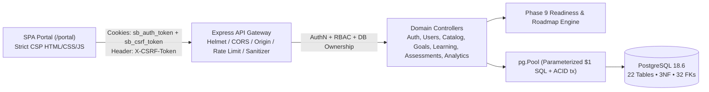

# SkillBridge AI — Universal Career Gap Tracker & Learning Engine


-4169E1?logo=postgresql&logoColor=white)


A full-stack career intelligence and upskilling platform built on a **Third Normal Form (3NF) PostgreSQL schema (22 tables)**, an **Express REST API Gateway**, a **Multi-Factor Readiness & Roadmap Engine**, and a **strict-CSP Candidate & Counselor Web Portal**.

---

## Table of Contents

- [Project Introduction](#project-introduction)
- [Problem Statement](#problem-statement)
- [Project Objectives](#project-objectives)
- [Key Features](#key-features)
- [Technology Stack](#technology-stack)
- [Screenshots & Diagrams](#screenshots--diagrams)
- [Architecture Diagram](#architecture-diagram)
- [Application Workflow](#application-workflow)
- [Project Directory Structure](#project-directory-structure)
- [Database Design](#database-design)
- [API Documentation](#api-documentation)
- [Installation Instructions](#installation-instructions)
- [Environment Variables](#environment-variables)
- [How to Run Locally](#how-to-run-locally)
- [Usage Examples & Real-World Scenarios](#usage-examples--real-world-scenarios)
- [Testing Instructions & Results](#testing-instructions--results)
- [Deployment Instructions](#deployment-instructions)
- [Security Considerations](#security-considerations)
- [Future Improvements](#future-improvements)
- [Contribution Guidelines](#contribution-guidelines)
- [License](#license)
- [Author](#author)

---

## Project Introduction

**SkillBridge AI** evaluates a candidate's real qualifications—academic degrees, verified skills, work/volunteer tenure, licenses, and assessment scores—against target job roles across any professional discipline. Instead of hardcoding domain-specific columns (such as software-only coding metrics), SkillBridge AI models requirements polymorphically so Software Engineering, Healthcare, Finance, Education, Civil Engineering, and Civil Service roles all run on the same relational core.

---

## Problem Statement

Conventional career trackers and applicant screening tools suffer from three structural limitations:
1. **Domain Silos:** Tools tailored exclusively to software developers fail healthcare practitioners, accountants, teachers, and tradespeople.
2. **Stigma Around Career Breaks:** Automated resume filters penalize employment pauses (medical recovery, caregiving, parental leave, education) instead of comparing actual retained competencies against role standards.
3. **Weak Authorization & Schema Hygiene:** Prototype career portals frequently mix unvalidated JSON inputs, weak cross-candidate access controls (IDOR), and unstructured skill fields.

---

## Project Objectives

- Build a **sector-agnostic, 3NF PostgreSQL database** (22 tables, 32 foreign key constraints) capable of representing multi-disciplinary career requirements and neutral career breaks.
- Implement a quantitative **5-factor readiness scoring engine** and dependency-sequenced **learning roadmap generator**.
- Deliver an **authenticated REST API Gateway** enforced by HTTP-only JWT cookies, HMAC session-bound CSRF tokens, RBAC role separation, database-backed anti-IDOR ownership checks, and strict Content-Security-Policy (CSP).
- Preserve all committed data invariants (`Zero-Mutation` test guarantee: 22 tables, 157 baseline records, 0 orphan FKs).

---

## Key Features

- **Multi-Factor Readiness Engine (`readinessEngine.js`):** Weighted evaluation across **Skills (40%)**, **Experience (20%)**, **Education (20%)**, **Certifications (10%)**, and **Assessments (10%)**.
- **Automated Gap Detection & Learning Roadmaps:** Compares candidate profiles against polymorphic role requirements (`career_requirements`) and sequences catalog resources (`learning_resources`) by severity and priority.
- **Ethical Career Break Intake:** Captures career breaks neutrally (`parental_leave`, `health`, `caregiving`, `education`, `travel`, `personal`, `layoff`, `career_change`, `other`) without score penalization.
- **Role-Separated SPA Portal (`/portal`):** 12 interactive views for Candidates (dashboard gauge, profile, skills/breaks, readiness breakdown, gap matrix, learning roadmap, assessments & growth) and Counselors (cohort dashboard, directory, at-risk analytics, RBAC tester).
- **Executive Cohort Analytics (Queries 1–15):** Sub-15ms Multi-CTE SQL dashboard isolating readiness, gap counts, break cohorts, and learning velocity without Cartesian row explosion.

---

## Technology Stack

| Layer | Technologies Verified in Repository |
| :--- | :--- |
| **Runtime & Backend** | Node.js 24 (ES Modules), Express `4.21.2`, `pg` (`node-postgres` `8.13.3`) |
| **Security & Auth** | `bcrypt` `6.0.0` (cost factor 12), `jsonwebtoken` `9.0.3` (`HS256`), `helmet` `8.0.0`, `cors` `2.8.5`, `express-rate-limit` `7.5.0`, `zod` `3.24.2`, Node `crypto` HMAC-SHA256 |
| **Frontend Portal** | Vanilla ES JavaScript (`backend/public/app.js`), HTML5 (`index.html`), CSS3 (`styles.css`) — zero inline scripts/styles |
| **Database** | PostgreSQL `18.6` (Docker Compose targets PostgreSQL `17-alpine`) |
| **Testing & Tooling** | Node.js built-in test runner (`node --test`), `supertest` `7.0.0` |
| **Containers & Docs** | Multi-stage `Dockerfile` (`node:24-alpine`, `USER node`), `docker-compose.yml`, DBML, Mermaid, PlantUML |

---

## Screenshots & Diagrams

Live UI browser screenshots have not yet been captured as image files in the repository. Verified architecture and database relationship diagrams are committed under [`documentation/`](./documentation):

- **System Architecture:** [`documentation/System_Architecture.png`](./documentation/System_Architecture.png)
- **Entity-Relationship Diagram:** [`documentation/ER_Diagram.png`](./documentation/ER_Diagram.png)
- **Database Relationship Diagram:** [`documentation/Database_Relationship_Diagram.png`](./documentation/Database_Relationship_Diagram.png)
- **Data Flow Diagrams:** [`DFD_Level_0.png`](./documentation/DFD_Level_0.png) & [`DFD_Level_1.png`](./documentation/DFD_Level_1.png)

---

## Architecture Diagram



---

## Application Workflow

1. **Authentication & Session Establishment:** Candidates register (`POST /api/auth/register`), activate provisioned accounts via 256-bit single-use SHA-256 tokens (`POST /api/auth/activate-account`), or log in (`POST /api/auth/login`) to receive an HTTP-only `HS256` JWT cookie (`sb_auth_token`) and a session-bound HMAC CSRF cookie (`sb_csrf_token`).
2. **Profile & Goal Curation:** Candidates manage education, skills, work/volunteer experiences, certifications, career breaks, and target roles (`/api/users/:id/*`, `/api/users/:id/goals`).
3. **Readiness Evaluation & Gap Analysis:** Calling `/api/goals/:goalId/analyze` calculates the 5-component readiness score and pinpoints unmet requirements.
4. **Learning Roadmap & Verification:** `/api/goals/:goalId/generate-roadmap` produces ordered study steps linked to catalog resources, and `/api/assessments/:id/submit` tracks verified quiz scores and retake growth.
5. **Counselor Oversight:** Counselors/Admins monitor cohort readiness, at-risk candidates (`< 60%`), break impact, and task velocity via `/api/analytics/*`.

---

## Project Directory Structure

```text
SkillBridge-AI/
├── .dockerignore
├── .gitignore
├── DATABASE_SCHEMA_SUBMISSION.md     # Complete internship database deliverable
├── DEPLOYMENT.md                     # Hosting, TLS proxy & pg_dump/pg_restore runbook
├── Dockerfile                        # Multi-stage Node 24 Alpine build (non-root USER node)
├── docker-compose.yml                # Isolated PostgreSQL + API orchestration
├── schema.sql                        # PostgreSQL DDL (22 tables, CHECKs, 32 FKs, 12 indexes)
├── sample_data.sql                   # Transactional seed data (157 rows across 3 personas)
├── test_queries.sql                  # Analytical Queries Q1–Q15
├── integrity_checks.sql              # Read-only 13-check relational integrity audit
├── er-diagram.dbml                   # Visual DBML definition
├── normalization.md                  # 1NF, 2NF, 3NF verification proof
├── migrations/                       # Staged SQL migrations (001, 002 + down scripts)
├── documentation/                    # PNG/MMD/PUML architecture & PDF/DOCX reports
└── backend/
    ├── .env.example
    ├── package.json
    ├── server.js                     # Server bootstrap & graceful SIGTERM/SIGINT shutdown
    ├── public/                       # Strict-CSP 12-page SPA (index.html, app.js, styles.css)
    ├── scripts/                      # generate-activation-token.js, provision-counselor.js
    ├── src/
    │   ├── app.js                    # Middleware pipeline & /portal static hosting
    │   ├── config/                   # env.js (fail-fast prod check) & db.js (pg.Pool + SSL)
    │   ├── controllers/              # Route handlers for Auth & Domains 1–6
    │   ├── middleware/               # auth.js (RBAC + DB IDOR), csrf.js, security.js, validate.js
    │   ├── queries/                  # Parameterized PostgreSQL SQL modules
    │   ├── routes/                   # REST routers with Zod param & body validation
    │   ├── services/                 # Domain logic & readinessEngine.js
    │   ├── utils/                    # inputSanitizer.js (XSS/proto/multipart defenses)
    │   └── validators/               # Schema-aligned .strict() Zod schemas
    └── tests/
        ├── unit/                     # 11 unit security & domain test suites
        └── integration/              # 20 Supertest + live PostgreSQL test suites
```

---

## Database Design

- **22 Normalized Tables (3NF)** organized into 5 layers: User Profile (`users`, `education_records`, `user_skills`, `user_experiences`, `user_certifications`, `career_breaks`), Career Catalog & Goals (`career_fields`, `skills`, `qualification_types`, `career_roles`, `certifications`, `career_goals`, `career_requirements`), Gap Analysis (`gap_types`, `career_gap_analyses`, `career_gap_items`), Learning (`learning_resources`, `resource_skills`, `learning_plans`, `learning_plan_items`), and Assessments (`assessments`, `assessment_results`).
- **3 Associative Junction Tables:** `user_skills`, `user_certifications`, `resource_skills`.
- **Integrity Enforcements:** 22 surrogate `SERIAL` PKs, 11 `UNIQUE` constraints, 32 explicit foreign keys, polymorphic `CHECK` mutual exclusivity (`chk_career_req_exclusive_fks`), and 12 explicit query-path indexes. See [`DATABASE_SCHEMA_SUBMISSION.md`](./DATABASE_SCHEMA_SUBMISSION.md).

---

## API Documentation

| Group | Key Endpoints | Access / Auth |
| :--- | :--- | :--- |
| **Health & CSRF** | `GET /api/health`, `GET /api/auth/csrf-token` | Public |
| **Authentication** | `POST /api/auth/register`, `POST /api/auth/login`, `POST /api/auth/activate-account`, `POST /api/auth/logout`, `GET /api/auth/me` | Public / JWT |
| **Candidate Profile** | `GET /api/users`, `GET/POST/PUT /api/users/:id`, `/education`, `/skills`, `/experiences`, `/certifications`, `/career-breaks` | Owner / Counselor + CSRF |
| **Catalog** | `GET /api/catalog/fields`, `/roles`, `/roles/:id`, `/skills`, `/qualifications`, `/certifications` | Public |
| **Goals & Readiness** | `GET/POST /api/users/:id/goals`, `/goals/:goalId/skill-match`, `/goals/:goalId/analyze`, `/goals/:goalId/generate-roadmap`, `/analyses/:analysisId` | DB Resource Owner / Counselor + CSRF |
| **Learning Plans** | `GET /api/users/:id/learning-plans`, `GET /api/learning-plans/:planId`, `POST /api/goals/:goalId/learning-plans`, `PATCH /api/learning-plan-items/:itemId`, `GET /api/resources` | DB Owner / Public (`resources`) |
| **Assessments** | `GET /api/assessments`, `GET /api/assessments/:id`, `POST /api/assessments/:id/submit`, `GET /api/users/:id/assessments`, `/growth` | Public Catalog / Body Owner + CSRF |
| **Executive Analytics** | `GET /api/analytics/dashboard`, `/at-risk`, `/career-breaks`, `/task-summary` | Counselor / Admin Only |

See [`documentation/API_AUTHENTICATION_GUIDE.md`](./documentation/API_AUTHENTICATION_GUIDE.md) for payload examples.

---

## Installation Instructions

```bash
git clone https://github.com/mohan5535/SkillBridge-AI.git
cd SkillBridge-AI
npm --prefix backend install
```

Create and populate the PostgreSQL database (`skillbridge_db`):

```bash
createdb -U postgres skillbridge_db
psql -U postgres -d skillbridge_db -f schema.sql
psql -U postgres -d skillbridge_db -f sample_data.sql
```

---

## Environment Variables

Copy `backend/.env.example` to `backend/.env`:

| Variable | Description | Default / Example |
| :--- | :--- | :--- |
| `PORT` | Backend API listening port | `5000` |
| `NODE_ENV` | Runtime mode (`development` or `production`) | `development` |
| `PGHOST`, `PGPORT`, `PGDATABASE`, `PGUSER` | PostgreSQL connection coordinates | `127.0.0.1`, `5432`, `skillbridge_db`, `postgres` |
| `PGPASSWORD` | PostgreSQL password (required in production) | *(local secret)* |
| `PGSSL`, `PGSSL_REJECT_UNAUTHORIZED` | Enable TLS for managed PostgreSQL | `false`, `true` |
| `CORS_ORIGIN` | Allowed origins (comma-separated in production) | `http://localhost:3000` |
| `RATE_LIMIT_WINDOW_MS`, `RATE_LIMIT_MAX` | Express rate-limit window & request cap | `900000`, `100` |
| `JWT_SECRET`, `JWT_EXPIRES_IN` | `>=32`-char signing key & JWT lifetime | *(CSPRNG hex)*, `30m` |
| `CSRF_SECRET`, `COOKIE_SECRET` | `>=32`-char HMAC CSRF & cookie signing secrets | *(CSPRNG hex)* |
| `ALLOW_DEMO_SESSION` | Enable persona switcher endpoint (`false` recommended in prod) | `true` in dev / `false` in prod |

---

## How to Run Locally

```bash
cp backend/.env.example backend/.env
# Configure PGPASSWORD, JWT_SECRET, CSRF_SECRET, and COOKIE_SECRET in backend/.env
npm --prefix backend start
```

- Web Portal: `http://localhost:5000/portal`
- Health Check: `http://localhost:5000/api/health`

---

## Usage Examples & Real-World Scenarios

### Scenario 1: Candidate Returning After a Career Break

A software developer or registered nurse returning from a `parental_leave` or `caregiving` break registers, logs their career break neutrally, evaluates readiness against a target role, and generates an ordered upskilling roadmap:

```bash
# 1. Register candidate (receives HttpOnly sb_auth_token + sb_csrf_token cookies)
curl -c cookies.txt -X POST http://localhost:5000/api/auth/register \
  -H "Content-Type: application/json" \
  -d '{"email":"candidate@example.org","full_name":"Asha Nair","password":"StrongCandidatePass123!","country":"India"}'

# 2. Fetch active CSRF token from sb_csrf_token cookie (rawToken before ".") and evaluate a goal
curl -b cookies.txt -X POST http://localhost:5000/api/goals/1/analyze \
  -H "Content-Type: application/json" \
  -H "X-CSRF-Token: <rawToken>"

# 3. Generate sequenced learning roadmap from missing/below-target gaps
curl -b cookies.txt -X POST http://localhost:5000/api/goals/1/generate-roadmap \
  -H "Content-Type: application/json" \
  -H "X-CSRF-Token: <rawToken>"
```

### Scenario 2: Counselor Reviewing At-Risk Cohort

Career counselors authenticate with a provisioned counselor account and query cohort-wide analytics without exposing individual candidate mutation rights:

```bash
# Multi-CTE executive dashboard (readiness, gaps, active plans) + candidates below 60% readiness
curl -b counselor_cookies.txt http://localhost:5000/api/analytics/dashboard
curl -b counselor_cookies.txt http://localhost:5000/api/analytics/at-risk
```

---

## Testing Instructions & Results

```bash
# Run complete unit + live PostgreSQL integration test suite
npm --prefix backend run test

# Run unit tests only (in-memory, no live DB required)
npm --prefix backend run test:unit

# Run API integration tests against PostgreSQL
npm --prefix backend run test:integration

# Run zero-mutation database cardinality & FK audit
npm --prefix backend run test:audit

# Run full test suite with detailed code coverage report
npm --prefix backend run test:coverage
```

**Verified Test Result (`npm --prefix backend run test:coverage`):**
- **288 / 288 tests passed** across **71 suites** (`0` failed, `0` skipped) against live **PostgreSQL 18.6** (exceeding the 278 test benchmark).
- **Native Node.js Code Coverage (Aggregate across all source files):**
  - **Lines:** **96.39%** ($\ge 80.0\%$ threshold)
  - **Branches:** **88.69%** ($\ge 80.0\%$ threshold)
  - **Functions:** **94.92%** ($\ge 80.0\%$ threshold)
- **Coverage Engine Specifics & Distinctions:**
  - **Engine:** Measured via Node.js native V8 coverage (`--experimental-test-coverage`). Native Node.js reports **Lines**, **Branches**, and **Functions**. Independent statement coverage requires AST-based tooling such as `c8` and is not estimated or conflated with line coverage.
  - **Aggregate vs. Individual Coverage:** Aggregate codebase coverage stands at 96.39% Lines, 88.69% Branches, and 94.92% Functions. Individual modules range from 75.50% to 100.00% Lines, with 100% Lines & Branches achieved across all 6 Express controllers. Full per-file coverage is documented in [`TESTING_REPORT.md`](./TESTING_REPORT.md).
- **Database Guarantees:**
  - Verified **22 tables**, exactly **157 baseline committed records**, **0 orphan FKs**, and safe in-memory rollback guarantees (`Zero-Mutation` verified).
  - Strict CSP headers (`0` browser CSP violations), cryptographic anti-tampering (HMAC-SHA256, bcrypt cost factor 12), and cross-candidate anti-IDOR isolation.

---

## Deployment Instructions

Full production checklist, secret generation, reverse-proxy TLS forwarding (`X-Forwarded-Proto: https`), and `pg_dump`/`pg_restore` backup procedures are documented in [`DEPLOYMENT.md`](./DEPLOYMENT.md).

```bash
docker compose up --build -d
```

---

## Security Considerations

- Production startup (`NODE_ENV=production`) fails closed if `JWT_SECRET`, `CSRF_SECRET`, `COOKIE_SECRET`, or `PGPASSWORD` are missing or match dev/placeholder strings.
- JWT signing and verification pin `HS256`; HTTP-only cookies enforce `SameSite=Strict` and `Secure` in production.
- CSP enforces `script-src 'self'`, `script-src-attr 'none'`, `style-src-attr 'none'`, `object-src 'none'`, and `frame-ancestors 'none'` (zero `'unsafe-inline'`).
- Note: Staged migration [`migrations/002_add_user_auth_credentials.sql`](./migrations/002_add_user_auth_credentials.sql) must be executed before persistent DB-backed credential login replaces the fallback auth store in fresh production setups.

---

## Future Improvements

- Execute Migration `002` in production deployments and wire SMTP/transactional email delivery for activation tokens.
- Self-host typography assets under `/portal` to tighten CSP `style-src` and `font-src` exclusively to `'self'`.
- Capture and commit high-resolution desktop and mobile portal screenshots into `documentation/`.

---

## Contribution Guidelines

1. Fork the repository and create a feature branch (`git checkout -b feat/your-change`).
2. Ensure all schema changes preserve 3NF integrity and never commit `.env` or `.dump` files.
3. Add or update unit/integration tests and confirm `npm --prefix backend run test` passes cleanly before opening a Pull Request.

---

## License

No `LICENSE` file is currently present in this repository. All rights remain with the author unless an explicit open-source license (such as MIT) is added.

---

## Author

**Mohan Mandal**  
GitHub: [@mohan5535](https://github.com/mohan5535)
